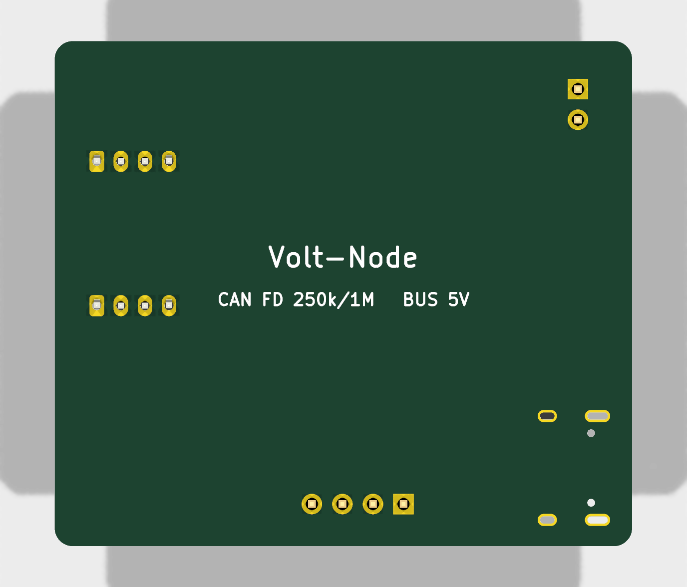

# Узел «вольтметр»

Первый узел внутренней шины. Схема измерительного тракта взята у
[volt_probe](https://github.com/gravitymir/volt_probe) без изменений — меняется
то, что стоит **после** тракта.

Состояние: **схема готова и проверена, размещение - первый проход, разводки нет.**

| сверху | снизу |
|---|---|
|  |  |

## Что меняется против volt_probe

### Аналог больше не ходит по проводам

У `volt_probe` выход `OUT` — это **напряжение**, и оно идёт по проводу до АЦП
контроллера. Провод метровый, неэкранированный, рядом машина с зажиганием.
Это самое слабое место старого модуля: приходится следить за длиной провода и
всё равно ловить мусор.

На узле АЦП стоит **на той же плате**, в десятке миллиметров от усилителя.
По кабелю наружу уходит только дифференциальный CAN. Аналоговой проблемы больше
нет — не «уменьшена», а исчезла.

Это, пожалуй, лучший пример того, зачем вообще нужны умные узлы.

### Узел распознаёт провод сам

Тракт `volt_probe` сделан **быстрым** намеренно: полоса около 0.5 МГц, чтобы по
осциллограмме можно было опознать, что за провод под щупом — масса, питание,
LIN, K-line, CAN, ШИМ форсунок.

Раньше для этого надо было гнать поток отсчётов в мозг. По шине управления так
делать нельзя, да и незачем: у G0B1 есть АЦП на 2.5 Msps и 144 КБ ОЗУ. Узел
набирает осциллограмму локально, разбирает её сам и отдаёт на шину **вывод**, а
не поток: «постоянные 12.4 В», «K-line, 10.4 кбит/с», «ШИМ 150 Гц, 32 %».

Полную осциллограмму можно запросить отдельной командой, когда она
действительно нужна.

### Опора измеряется, а не предполагается

Опора 1.65 В получена делителем 10к/10к от того же +3.3 В, что питает АЦП, то
есть ратиометрична: ноль всегда приходится на середину шкалы. Но теперь
**вторая половина делителя доступна второму каналу АЦП** — опору можно мерить, а
не считать идеальной, и вычитать её дрейф из результата.

### Коэффициент зашит в прошивку, а не в шелкографию

`V = (V_out − 1.65) × 26.11`

На платах `volt_probe` первой партии напечатано `x27.1` — это ошибка, показания
по ней завышены на 3.8 %. Здесь число живёт в прошивке узла, и наружу идёт уже
готовое напряжение в вольтах. Ошибиться при чтении шелкографии больше негде.

## Состав платы

### Измерительный тракт — как в volt_probe

| | |
|---|---|
| LMV358 | обе половинки: дифусилитель и буфер опоры |
| R1, R2 — 470 кОм 0805 | вход, 150 В на корпус |
| R3, R4 — 18 кОм | коэффициент `18/470 = 0.0383` |
| R5, R6 — 10 кОм | делитель опоры 1.65 В |
| R7 220 Ом + C1 470 пФ | развязка от входной ёмкости АЦП |
| D1, D2 — BAT54S | клампы входов ОУ к рельсам |

Диапазон ±43 В, входное сопротивление около 488 кОм на щуп, вход держит выбросы
до ±80 В и случайные 220 В.

Щупы припаиваются проводами прямо к плате — колодки для них не ставим.

### Новое: мозг, шина, питание

| | |
|---|---|
| STM32G0B1CBT6 | LQFP-48, кварц обязателен |
| TCAN332G | трансивер CAN FD |
| AP2112K-3.3 | LDO из 5 В шины в 3.3 В |
| J1, J2 | `S4B-PH-K-S` — шина, параллельно, гирляндой |
| JP1 | 120 Ом терминатор на перемычке, **разомкнут** |
| J3 | USB-C — прошивка и питание на столе |
| SW1, SW2 | RESET и BOOT |

### Про USB-C и кнопки

Прошивка идёт без программатора, потому что у G0B1 **загрузчик зашит в ПЗУ** и
умеет и USB DFU, и FDCAN. Подробности и распиновка — в
[docs/BUS.md](../../docs/BUS.md).

На столе: воткнул USB-C, зажал `BOOT`, нажал и отпустил `RESET`, отпустил
`BOOT` — плата видна как DFU-устройство. Кварц для этого не нужен, USB тактуется
от внутреннего HSI48.

В собранном приборе кнопки не нужны вовсе: узел прыгает в загрузчик по команде
с шины. Кнопки — аварийный путь, когда прошивка не стартует и команду принять
некому.

**Выводы `PD0`, `PD1`, `PA11`, `PA12`, `NRST` и `BOOT0` трогать нельзя** —
они жёстко заняты ПЗУ-загрузчиком.

## Что сделано и что нет

**Готово:** схема целиком, 26 позиций в спецификации, все номера LCSC
проставлены и разрешаются. Размещение - первый проход: перекрытий корпусов нет,
замыканий нет.

**Не сделано:** разводка. 109 несоединённых контактов в DRC - это она и есть.

### Проверки

Сравнивалось с `volt_probe`, по которому платы уже изготовлены, чтобы отличить
настоящие замечания от особенностей генератора:

| | Volt-Node | volt_probe (изготовлена) | |
|---|---|---|---|
| `net_conflict` | 14 | 13 | особенность связки генератор + CLI |
| `clearance` в SOT-23-8 | 6 | — (у `can_probe` те же) | зазор 0.15 мм при правиле 0.2; минимум JLCPCB 0.09 |
| `endpoint_off_grid`, `lib_symbol_mismatch` | есть | есть | особенность генератора |
| `unconnected_items` | 109 | 0 | **разводки ещё нет** |

ERC поймал одну настоящую ошибку: `SWDIO` висел в воздухе. Исправлено - добавлен
`J5 SWD`.

### Что нужно поправить на следующем проходе

- **USB-C не выставлен на край платы.** Сейчас `J3` стоит внутри контура, а его
  окно обязано выходить за край, иначе кабель не воткнуть. Это первое, что надо
  сделать при размещении.
- **Ориентацию `J1`/`J2` проверить глазами в KiCad.** Колодки боковые, их окна
  должны смотреть наружу, вправо.
- **Плата великовата.** 48 x 42 мм при том, что детали занимают процентов
  шестьдесят. После разводки должна ужаться примерно до 40 x 35.
- **`D4` далеко от `J3`.** Диод развязки USB стоит слева вверху, а разъём -
  слева внизу; цепь `VBUS` получается длинной. Поставить диод рядом с разъёмом.
- **Обозначения налезают друг на друга** в аналоговом блоке - 11 пересечений
  шелкографии. Решается на этапе разводки, вместе с расстановкой подписей.
- **Защиты по USB нет.** Супрессоры на `D+`/`D-` и на `VBUS` не поставлены.
- **Раздел земли** между аналоговым трактом и цифрой не продуман: выиграв на
  длине провода, можно проиграть на помехах от самого микроконтроллера.
- `JP1` даёт одно косметическое замечание DRC: у футпринта стоит флаг
  «исключить из BOM», у символа нет. На плату не влияет.

## Сборка

```bash
sh nodes/volt/hardware/gen/check.sh
```

Нужен Python из KiCad 10. Скрипт пересобирает плату и прогоняет DRC со сверкой
схемы, ERC и собственные проверки.
